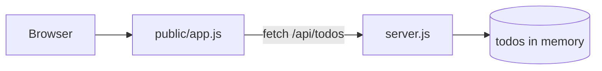

# Modes: map and explain FILE

**Contents:** 1. map (project map) · 2. explain FILE (file card) · 3. Risk levels · 4. Plain-English job phrases

## 1. `map` — the project map

Goal: one screen that tells the user what every important file is for.

Steps:
1. Print the scanner `tree` (depth 3) in a code block.
2. Build the file table (assets/templates/file-table.md) for the **important** files only:
   entry points, routes, pages/components, config, `.env*`, `package.json`, README. Up to 20 rows.
   Group the rest: "`public/images/` — 14 pictures used by the site".
3. Add one ASCII diagram of how the folders connect.
4. Offer to save a Mermaid version to `VIBE_MAP.md` (ask first).

File table columns:

| File | Job in plain English | Talks to | Risk |
|---|---|---|---|
| `server.js` | The kitchen: starts the server and answers `/api/*` requests | `public/app.js` (receives), memory (stores to-dos) | 🔴 hard-coded key at line 9 |

Rules:
- "Job" in 12 words or fewer, no jargon (or jargon explained).
- "Talks to" = files it imports or calls, plus who calls it (imports, `fetch` URLs, routes).
- Risk = the highest risk found in that file (section 3).
- Sort: entry points first, then backend, frontend, config, docs.

Mermaid version for `VIBE_MAP.md` (only after a yes):

## 2. `explain FILE` — the file card

Goal: the user understands one file without reading code.

Steps:
1. Read the whole file. If it has more than 400 lines, read it in parts and say so.
2. Find who uses it: search the project for its name, exported functions or route URLs.
3. Fill assets/templates/file-card.md:
   - **What it does** (up to 3 bullets)
   - **Who calls it** (files + lines)
   - **What it calls** (imports, APIs, database)
   - **Walkthrough**: Lines | What happens (plain English). Up to 8 rows.
   - **Risky lines**: `file:line` + a 1-line why + severity emoji.
   - **Try this**: one tiny safe experiment ("change the text on line 12 and refresh").
4. Level `junior` → you may quote up to 10 lines of code. Otherwise up to 3.

If the user names a file that doesn't exist, show the 5 closest names from the tree and ask.

## 3. Risk levels

| Emoji | Meaning | Examples |
|---|---|---|
| 🟢 | Fine | Nothing worrying found |
| 🟡 | Worth improving | Long function, no error handling, `console.log` leftovers, magic numbers |
| 🔴 | Fix soon | Hard-coded secret, no input validation on a write route, `eval`, SQL built from strings, missing auth |

Always cite the line. If unsure, say "possible" and what you'd need to check.

## 4. Plain-English job phrases (reuse these)

| File / folder | Job phrase |
|---|---|
| `package.json` | The shopping list: which helper packages the app needs, plus its start commands |
| `package-lock.json` | The exact receipt of every package version installed (don't edit by hand) |
| `node_modules/` | The downloaded packages themselves (never edit, never commit) |
| `.env` | The locked safe for secret settings like API keys |
| `.env.example` | The safe's labels with no real values, so others know what to fill in |
| `.gitignore` | The list of files Git should never upload |
| `README.md` | The instruction manual on the front door |
| `public/` | Files sent to the browser as-is (images, icons, plain HTML) |
| `src/` | The app's own source code |
| `components/` | Reusable building blocks of the page |
| `pages/` or `app/` | One file per page or address (Next.js) |
| `api/` or `routes/` | The server's addresses that answer requests |
| `server.js` / `index.js` | The front door of the backend: starts the server |
| `middleware/` | Security guards that check every request before it reaches a route |
| `models/` / `schema.prisma` | The shape of the data in the database |
| `tests/` / `*.test.js` | Automatic checks that the code still works |
| `.github/workflows/` | Robots that run checks every time code is pushed |
| `vite.config.js` / `next.config.js` | Settings for the build tool |
| `tailwind.config.js` | Settings for the styling helper |
| `requirements.txt` | Python's shopping list |
